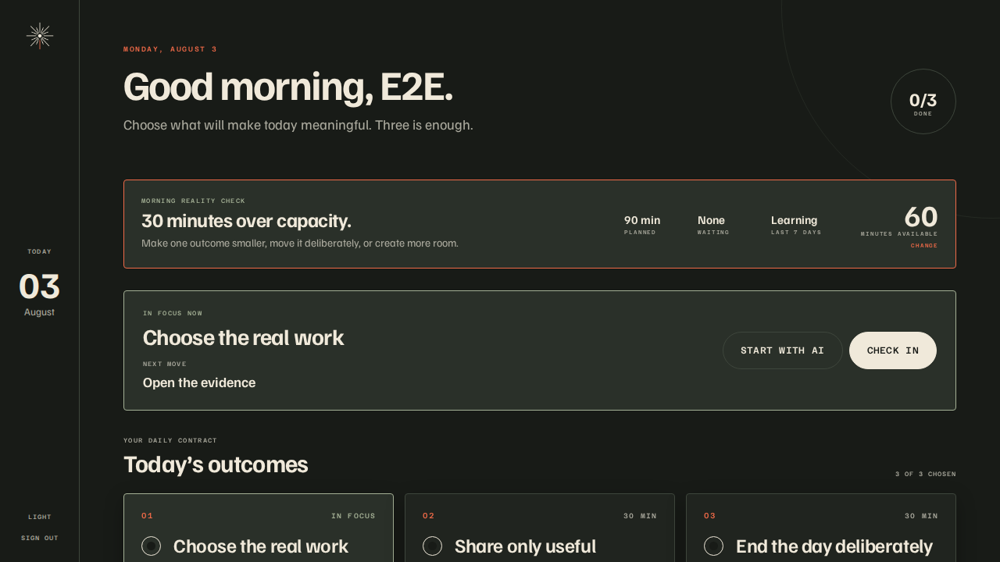

# Saltzer

**The daily execution system for humans working with AI.**

Most task managers become graveyards. Saltzer is deliberately smaller: decide
what matters today, give it enough context to act, and release the rest without
guilt.

Saltzer is open-source software licensed under the AGPL-3.0. The product is in
active development. The Daily Contract and its focus/progress loop are shared
by the web, native, CLI, and MCP clients.



## Product principles

- Today is the product. A day holds at most three meaningful outcomes.
- Context belongs beside the intention, ready for a human or an AI to use.
- Unfinished work is reconsidered, never silently converted into permanent debt.
- Strong defaults beat settings. Speed, restraint, and reliability are features.
- AI is optional and provider-neutral. Saltzer remains useful without a model.
- Healthy productivity matters more than maximizing completed task counts.
- Capacity is explicit, unknown work stays unknown, and recent behavior informs
  the morning without becoming a guilt score.
- Forward motion is explicit: one focus, one concrete next move, then an honest
  progress, pause, or blocker check-in.

## Repository map

```text
apps/
  api/       Hono HTTP API and authentication boundary
  cli/       `saltzer` command-line client
  e2e/       Playwright tests against the running product
  mcp/       MCP server for user-approved agent access
  product/   Expo Router app for iOS, Android, and web
packages/
  database/  PostgreSQL schema, migrations, and repositories
  domain/    Product rules and cross-surface schemas
  sdk/       Typed Saltzer API client
docs/        Product, architecture, and decision records
```

## Requirements

- Node.js 22+
- pnpm 11 (Corepack is recommended)
- Podman Compose or Docker Compose

## Local development

```bash
corepack enable
pnpm install
cp .env.example .env
pnpm db:up
pnpm db:migrate
pnpm dev
```

The API defaults to `http://localhost:4100` and the Expo development server
prints the web and native URLs it owns. Never commit `.env`; the tracked example
contains development-safe placeholders only.

## Quality checks

```bash
pnpm check
pnpm test
pnpm build
pnpm e2e
pnpm security:audit
pnpm performance:web
```

See [ARCHITECTURE.md](./ARCHITECTURE.md), [CONTRIBUTING.md](./CONTRIBUTING.md),
[the implementation-facing product vision](./docs/product/vision.md), and the
[founding product and business target](./docs/product/founding-product-business-target.docx)
for the product contract and engineering decisions.

## License

Copyright (c) 2026 Gabriel Gouvêa and contributors.

Saltzer is distributed under the [GNU Affero General Public License v3.0](./LICENSE).
